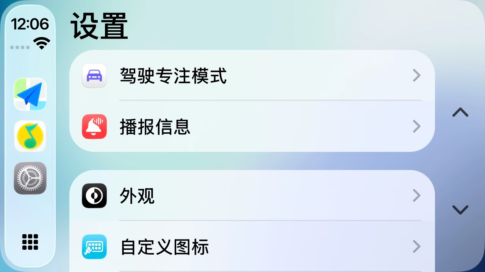
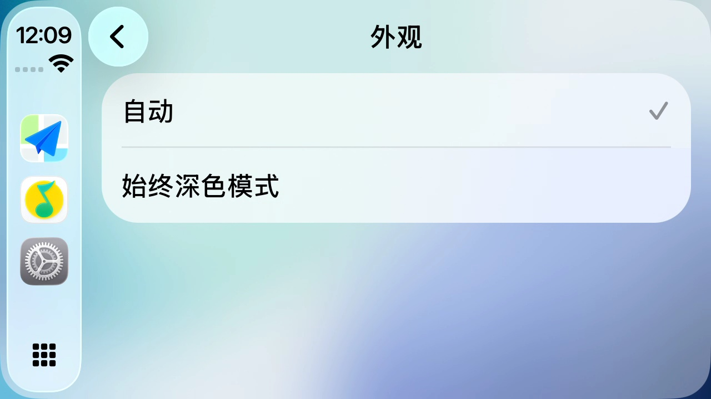
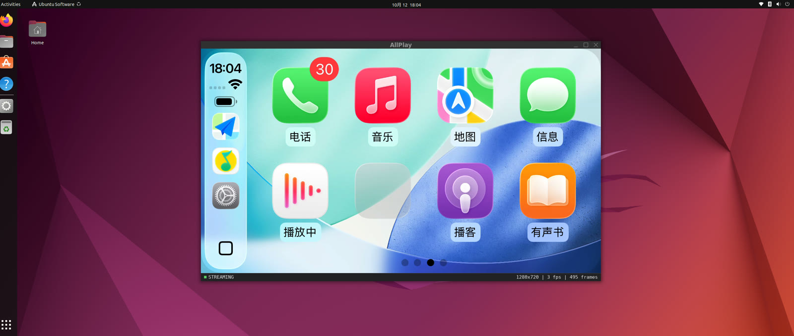

# 更新日志

版本号对应**平台能力**：每个版本打通一个平台的端到端渲染。
协议核心（`core/`）是所有平台共用的那一份，不在版本之间分叉。

格式参照 [Keep a Changelog](https://keepachangelog.com/zh-CN/1.1.0/)。

---

## [v0.4] — 有线（USB）CarPlay · 2026-10-13

**插上数据线就行。** 前几版走的都是无线（蓝牙叫醒 + 同一局域网）。这一版加了**有线**那条路：
USB 控制面整条自己写，媒体面交给内核，最后把手机引到和无线**同一套** RTSP / 加密 / 屏幕流代码上。

（上图：真 iPhone 插着数据线，宿主 `--wired` 跑在 Ubuntu 上 —— 这一轮宿主侧**渲染满 3000 帧**
正常退出，零 WARN/ERR。另有一轮探针侧的 200 秒长跑：收 1320 帧 / 12.4 MB，全程不掉线。）

（上图：`--inject-touch 0.5,0.72` 打在"外观"那一行上，手机**真的导航进了这一页** ——
投出去的事件通道 HID 有线这条路上一样被接受。）

### 新增

**有线控制面（`core/usb/`，平台无关）**
- `usbmux` v2：版本协商 + setup + 迷你 TCP（手机那侧是个 TCP 栈，成帧要自己来）。
- `wired_control`：串起手机要的三条连接 —— ① 明文 lockdown 配对 → ② 会话**原地升 TLS** →
  ③ `StartService(carkit)` 拿到的 iAP2 流。三条缺一条都拿不到最后那条服务流。
- `platform/posix/usb_libusb`：只做两件事 —— 把 iPhone 切进 **CarPlay 配置**（锁屏时它只报
  1 个配置，这是 iOS 的行为不是线的问题），以及把 USBMUX 口的 bulk 端点包成 `IByteStream`。

**有线 iAP2（`core/iap2/wired_link`）**
- 链路层**由主机发起**：发完 6 字节 marker 之后不等任何回话，自己立刻发 SYN 并每 500ms 重发。
  只发 marker 的话手机一声不吭（干等 260 秒零字节）—— 这是最早那版 naive 实现的死法。
- `0x4300` 解析 + `0x4301 CarPlayStartSession` 组装。有线组的报文结构容易搭错：
  地址是**每个地址一个 string 参数、重复 id 0**，不是字符串列表。

**有线媒体面**——**自己不写**。切进 CarPlay 配置后内核的 `cdc_ncm` 会建出一块真网卡，
AirPlay 直接绑到那块网卡的 IPv6 链路本地地址上，NTB16 / 以太网 / IPv6 全是内核的事。

**宿主 `--wired`（`host/wired_task`）**：和 `--bt` 对称，但**相位不同** —— 无线是
"Receiver 先起、手机找过来"，有线是"手机从 `0x4301` 里**读**地址"，所以 Receiver 必须等
USB 侧拆到知道 NCM 网卡叫什么、地址钉成哪个之后才能起。任务因此分两段（准备 / 保活），
`rx` 的生命周期仍然只有一个线程在管。准备失败时按 `W` 重来一次，不用重启程序。

**触摸**：有线这条路上触摸走的是**和无线完全相同**的那条事件通道（`POST /command` + 加密 HID），
一行都没改。真机验证：注入一次点击打在"外观"那一行，手机跟着进了该页（见上图）。

**探针**：`tools/usb_probe`（切配置）、`tools/wired_probe`（控制面，含 `--selftest` 离线自检）。

### 修复

下面这些**只有真机才暴露**。

- **`0x4301` 发了，手机却不来连 —— Receiver 绑错地址。** 有线这条路上地址是**我们先定好的**
  （NCM 网卡上的链路本地），`0x4301` 报的必须和 Receiver 实际监听的一模一样。原 `Receiver::start`
  拿"有没有 IPv4"当成功判据，而 NCM 网卡上**根本没有 IPv4**，于是它去绑通配 —— 手机照着
  `0x4301` 里的地址连过来，扑空。新增 `ReceiverConfig::bindAddr`：显式绑定跳过 IPv4 判据。
- **链路本地地址 `bind()` 报 EINVAL。** `fe80::/10` 的地址绑定必须带 `sin6_scope_id`，
  否则内核直接拒绝（而且报的是 EINVAL，看着像参数写错了）。现在 `bindAddr` 支持 `%网卡` 后缀，
  裸 `fe80:` 地址由 `Receiver` 自己补上 `%ifname`。
- **NCM 网卡上一个 IPv6 地址都没有。** 内核在它上面 `addr_gen_mode=1`（不生成任何地址），
  同时 NetworkManager 把这根点对点链路当"有线连接"去要 DHCP（那儿根本没有 DHCP 服务器），
  一直卡在 connecting 并随时可能清掉地址。新增 `allplay::posix::prepareWiredNcm`：
  `nmcli device set … managed no` → `ip link set up` → 钉 `fe80::2/64 … nodad`，
  网卡名按 USB `busnum`/`devnum` 反查 `/sys/class/net/*/device/..`（名字由 MAC 来，不能写死）。
- **控制面全绿、`RECORD` 也过了，然后卡在 `/feedback`** —— 每 2 秒一次，永远等不到画面。
  根因是 `SETUP` 里手机要屏幕流、我们没接 `IVideoOutput` 就没给 `dataPort`，手机拿不到数据端口
  只能干等。宿主本来就接了 sink，所以只有探针中招；已在探针里补一个只点数的 sink。
- **`pkill -f wired_probe` 会把执行它的那个 shell 一起杀掉**（shell 自己的命令行里就含这个串），
  于是"杀掉旧进程再重新编译"那条命令链在第 1 步就断了，后面的编译根本没跑，看起来却像编译失败。

### 注意

- 有线**只在 Linux 上做**：媒体面依赖内核 `cdc_ncm`，macOS / Windows 没有对应物。
- 没有 `libusb-1.0-dev` 时 CMake 会跳过整条有线链路，`--wired` 会明确报"这个构建没带 libusb"。
- 跑之前的三件前置（停 `usbmuxd`、`pkill gvfsd-gphoto2`、blacklist `apple_mfi_fastcharge`）
  和 `sudo` 环境下的两个坑见 [README 的有线前置条件](README.md#有线的前置条件linux缺一不可)。

---

## [v0.3] — 真 iPhone 端到端 · 2026-10-12

**手机是被宿主自己叫来的。** v0.2 证明的是"拿到流能渲染"，这一版证明的是"能主动把真机叫来"：
宿主发起蓝牙 iAP2 触发 → iPhone 经 mDNS 发现本机 → RTSP 协商 → 屏幕流上屏。
**CarPlay 画面出现在 Ubuntu 桌面上，触摸回传可点。**

### 新增

**蓝牙触发（桌面宿主）**
- `host/bt_task`：宿主从"只等手机来连"变成"自己把手机叫起来"。`runBtTrigger` 是全阻塞
  且**没有取消接口**的，所以放独立线程跑；失败按 3 秒间隔整链重试。线程把自己需要的
  transport 与参数全部 move 进闭包，退出时 detach 而非 join —— 否则一次退出最多卡 90 秒。
- 开关一律 opt-in，**不加 `--bt` 时行为与之前完全一致**：
  `--bt` / `--bt-addr` / `--bt-device` / `--bt-mode` / `--ssid` / `--wifi-pass` / `--bt-retry`。
  运行时按 `B` 可重新触发一次。

### 修复

下面这些**只有真机才暴露**，假手机一个都测不出来。

- **mDNS 的 TXT 记录是二进制垃圾 —— "手机根本不连"的根因。**
  `avahi_entry_group_add_service()` 是**可变参数**接口（`...` 是一串以 NULL 结尾的
  `const char*`），原代码传进去的是 `const char**`，avahi 于是把**指针数组自身的内存**
  当成第一个 TXT 字符串读，广播出去只有几个字节的乱码 —— 表象是"手机压根不来"，
  日志里一行 RTSP 都没有。iPhone 靠 TXT 里的 `features` / `flags=0x4` / `deviceid` /
  `srcvers` 认接收端，读不到就不连。改用 `avahi_entry_group_add_service_strlst()` +
  `AvahiStringList`（`avahi_string_list_add` 是头插，要倒着加才能保持原序）。
- **点图标毫无反应，拖地图却正常。** 触摸上报在抬起那一帧只发 `down=false`，
  坐标留在 (0,0) —— 手机收到的是"在图标处按下 → 在左上角抬起"，被判定成滑动而非点击。
  改为**抬起也带最后的位置**，与 Android 侧 `MainActivity.kt` 的 `ACTION_UP` 语义对齐。
- **断开后回不到启动页，画面卡在最后一帧。** "画面停住而不是消失"本来是给会话中途掉帧
  设计的，结果会话结束时纹理里那张末帧被 `present()` 一直重画 —— 日志明明打了"回启动页"，
  屏上却纹丝不动。新增 `SdlVideoSink::dropFrame()`，会话结束时丢掉。
- **开 `--statusbar` 就有黑边，且状态栏根本看不见。** 状态栏画在 `y = screenH`，
  可窗口只有 `screenH` 高 —— 整条落在窗口之外；渲染循环又按 `winH - barH` 排视频，
  16:9 被缩进 1280x694，左右各多出 23px 黑边。窗口高度改为 `screenH + barH`，两个毛病一起消失。
- **屏幕流被跳过时静默失败。** `video_` 为空时 `session.cpp` 原来直接 `continue`：
  不回 `dataPort`，手机干等 10 秒断开，而日志里一点提示都没有（排查时因此绕了很久）。
  补一条 WARN，只记日志、不改行为。

### 文档

- README 更新"当前状态"；新增排障条目 **"手机压根不来连 → 先查 mDNS TXT"**。

---

## [v0.2] — Ubuntu 平台渲染 · 2026-10-12

桌面宿主从"只有窗口"补齐到**能真正渲染出 CarPlay 画面**，并接上 Linux 蓝牙传输层。
与 v0.1 的 Android 端共用同一份 `core/`，只换了 `platform/` 和 `host/`。

### 新增

**视频**
- `host/media/ffmpeg_decoder` + `sdl_video_sink`：ffmpeg 软解 H.264/HEVC → SDL2 纹理，letterbox 上屏。
- 解码在 ScreenStream 线程做（对 TCP 收包形成自然背压），主线程只管抽帧渲染；
  帧队列有界，满时丢最旧帧保低延迟；尺寸/格式变化才重建纹理。

**音频**
- `host/media/sdl_audio_sink`：AAC-LC / Opus / LPCM 三种格式，SDL2 输出。
- **有意不引 libswresample** —— 它整套 channel-layout 参数在 ffmpeg 4.4 与 5.1+ 之间签名不同，
  而这里只需要"平面 float → 交织 s16"这一种转换，自己写反而更省事。
  版本差异全部收敛在 `host/media/ffmpeg_compat.h` 一个文件里。

**界面与输入**
- `host/launcher`：启动页（双色 logo + 蓝牙水纹 + 状态文字），与 Android 启动页对齐；
  连上后切全屏视频，状态栏退化为 `--statusbar` 显式开启的调试叠加。
- 触摸回传：鼠标 / 手指 → 按 **letterbox 后的视频矩形**归一化 → 事件通道。

**蓝牙（Linux）**
- `platform/posix/bt_bluez.cpp`：BlueZ 传输层，客户端模式（我们主动连手机的 iAP2 SPP 服务）。
  链路：SDP 查到 `00000000-deca-fade-deca-deafdecacafe` → **RFCOMM 通道 1** → 连上 →
  iAP2 识别 → 收到手机主动发来的 `0xAA00 请求证书`。
  真机（iPhone）验证到此为止，再往后需要 MFi 身份。

**验收工具**
- `tools/fake_phone`：假 iPhone。真 socket 跑完 RTSP + pair-setup/verify + ControlCipher 加密
  + 加密屏幕流推帧 —— **端到端验收不再需要 iPhone**。
- `tools/video_probe`：本地喂 AnnexB H.264 的解码冒烟工具。黑屏时先跑它二分：
  有画面 = 协议侧的锅，没画面 = 解码侧的锅。
- `tools/phone_crypto.h`：手机侧密码学从 `m3_test` 抽出来两边共用 ——
  抄两份的话它们会一起错，还会让"自测全绿但端到端失败"变成可能。

### 修复

- **SETUP 阶段 SIGSEGV**：`Receiver::start()` 把 `PlatformServices` 的**参数地址**存进了 Session，
  而 Session 到 SETUP 才第一次用它去建数据/事件通道，那时 `start()` 早已返回。改为自己持有一份。
- **关键帧判不出来、一直黑屏**：`ScreenStream::isRandomAccess()` 只看访问单元的第一个 NAL，
  而关键帧 AU 的常见排布是 `[SPS][PPS][IDR]`，首 NAL 是 SPS(7) 就被判成"非关键帧"——
  放行闸门永远打不开。改为扫完整个 AU。真机与假手机都会踩。

### 构建

- CMake 接 ffmpeg（avcodec/avutil/swscale，**不含** swresample）、bluez、dbus-1；
  缺 ffmpeg 时宿主降级为桩而不是整个跳过。
- 新增 `fake_phone` / `video_probe` 两个 target。

---

## [v0.1] — Android 平台渲染 · 2026-10-11

首个版本。协议核心从零实现，并在 Android 上端到端跑通。

### 新增

**协议核心 `core/`**（平台无关 C++，唯一三方依赖 OpenSSL）
- `airplay/rtsp`：极简 RTSP 服务器（控制通道，pair-verify 后加密）
- `airplay/session`：会话状态机 —— pair-setup / pair-verify / auth-setup / SETUP / RECORD
- `airplay/video_stream`：屏幕流 —— 128B 头解密 → AVCC→AnnexB → 关键帧闸门
- `airplay/audio_stream`：音频流 —— RTP over UDP 解密 + 序号乱序重排
- `airplay/event_channel`：事件通道 —— 触摸 HID 回传（最多 2 触点）+ forceKeyFrame 命令
- `airplay/control_cipher`：控制通道帧加密（ChaCha20-Poly1305）
- `iap2/`：iAP2 协议栈 —— 线格式 / 链路层（marker→SYN→ACK→NORMAL）/ 无线控制流程
- `mfi/mfi_identity`：MFi 配件身份接口（证书 + ECDSA 签名），**接口按硬件芯片的形状设计**，
  将来换成鉴权芯片实现时 core 不用动
- `crypto/`：加密原语全部从零实现（hkdf / chacha20poly1305 / srp6a / x25519 / ed25519 / tlv8 / aes_ctr）
- `bplist`：Apple 二进制 plist 编解码
- `bt/bt_trigger`：蓝牙触发编排（选设备 → RFCOMM → iAP2 → 0x4301 引导）

**Android 宿主**
- `MediaCodecSink`：MediaCodec 硬解 → Surface 直出
- `AudioSink`：AudioTrack 播放
- `BluetoothService` / `MdnsService` / `HotspotManager`：蓝牙、mDNS、热点
- 触摸回传、启动页与状态栏
- Gradle + NDK：Kotlin 外壳 + C++ core，经 `jni_bridge.cpp` 接系统 API
- `minSdk 28` / `targetSdk 34` / 仅 `arm64-v8a`

**平台适配**
- `platform/posix`：POSIX socket、avahi（Linux）/ dns_sd（macOS）、IOBluetooth、BlueZ（桩）
- `platform/windows`：Winsock2 + `AF_BTH`（骨架，未接宿主）

**自测**
- `core_selftest`（RTSP + `/info` + mDNS 广播）
- `iap2_test`（iAP2 线格式 + 链路层 + MFi 签名）
- `m3_test`（SRP 对 Python 参考向量 + 假手机全流程 + mock 屏幕流）

---

## 未发布

- **产品化的 MFi 身份**：`0xAA00 请求证书` 那道关要求 Apple MFi 计划签发的配件身份
  （`identity/`，不入库）。开发期用自备身份可以走通全链路 —— v0.3 的真机验证就是这么做的 ——
  但**纯软件身份不是产品路径**，要作为配件出货仍得走 MFi 计划。
- **桌面端音频**：真机那一轮 iPhone 只请求了屏幕流和 `type=130`，**没有请求任何音频流**，
  所以桌面端的音频链路至今只有假手机验证过，真机行为待观察。
