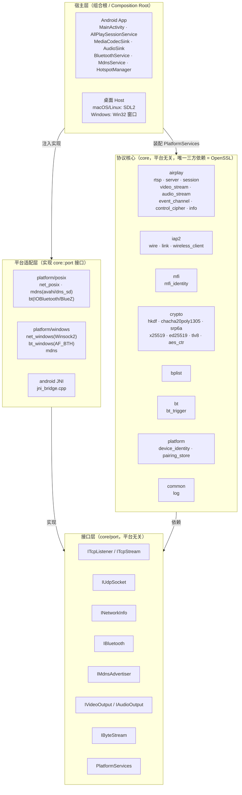
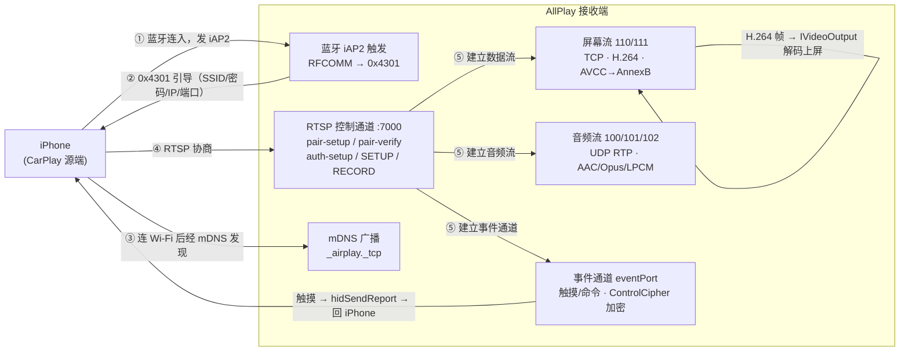

# AllPlay

**无线 CarPlay 接收端，跨平台。** 一份平台无关的 C++ 协议实现，把 iPhone 的 CarPlay 投到任意一块
屏幕上 —— 视频上屏、音频播放、触摸回传。

**协议核心只写一遍。** 每个平台只实现自己的"屏幕 / 喇叭 / 蓝牙 / 网络"，彼此平级 ——
没有主次平台，也不共享平台代码。

`GPL-3.0` · `Android ✅` · `Linux ✅` · `macOS ⏳` · `Windows ⏳`

---

## 这是什么

无线 CarPlay 本该是 iPhone 和车机之间的私有链路。AllPlay 实现的是**车机那一侧**：

| 步骤 | 做什么 |
|---|---|
| ① 蓝牙触发 | 连上 iPhone，走 iAP2 把它"叫醒"，并把 Wi-Fi 的 SSID / 密码 / 本机 IP 与端口告诉它 |
| ② 发现 | iPhone 连上同一局域网，经 mDNS（`_airplay._tcp`）发现本机 |
| ③ 协商 | RTSP 控制通道完成配对与流协商：屏幕流 / 音频流 / 事件通道 |
| ④ 投屏 | H.264 屏幕流解码上屏、音频流解码播放、触摸经事件通道回传 |

> **⚠️ 走完第 ① 步的最后一道关需要 Apple MFi 配件身份**（`identity/`）。
> 那是 Apple 签发的凭证，**不在本仓库里**，需自行准备。详见[当前状态](#当前状态)。

## 平台支持

| 平台 | 视频上屏 | 音频 | 蓝牙触发 | 状态 |
|---|---|---|---|---|
| **Android** | MediaCodec 硬解 → Surface | AudioTrack | `BluetoothSocket`（JNI） | ✅ 端到端跑通 |
| **Linux / Ubuntu** | ffmpeg 软解 → SDL2 纹理 | SDL2（AAC-LC / Opus / LPCM） | BlueZ：SDP + 裸 RFCOMM（客户端模式） | ✅ 端到端跑通 |
| **macOS** | 同 Linux（**共用同一份宿主代码**） | 同 Linux | IOBluetooth | ⏳ 宿主可跑，蓝牙未真机验收 |
| **Windows** | ffmpeg（待接） | — | `AF_BTH`（待接入） | ⏳ 骨架 |

- **没有主次平台。** 各家都只实现 `core/port` 的接口，互相不共享平台代码；
  桌面两平台共用 `host/`，只是因为它们恰好都用 SDL2。
- **验收方式统一。** 不管哪个平台，`tools/fake_phone` 都能扮演 iPhone 跑完整条链路 ——
  不需要真机，也不需要另一台设备。

## 架构

四层，**依赖单向朝内**：

```
host/          宿主层（组合根）—— 装配下面三层，管窗口/主循环/输入
platform/      适配层 —— 用系统 API 实现 core/port 的接口（POSIX / BlueZ / IOBluetooth / Win32 / JNI）
core/port/     接口层 —— 纯抽象，无实现（ITcpStream / IBluetooth / IVideoOutput / PlatformServices …）
core/          协议核心 —— 纯 C++，不含任何平台头，唯一三方依赖是 OpenSSL
```

**只有 `core/` 是"这个项目本身"**：RTSP、iAP2、加密原语、屏幕流、事件通道全在这里，
可以脱离任何平台单独编译和自测。平台差异一律通过 `core/port/*.h` 注入。

<details>
<summary>分层架构图（点击展开）</summary>



</details>

<details>
<summary>无线 CarPlay 数据流（点击展开）</summary>



</details>

逐模块职责与平台适配矩阵见 [`docs/architecture.md`](docs/architecture.md)；
协议细节（报文格式、握手流程）整理在 [`docs/PROTOCOL-NOTES.md`](docs/PROTOCOL-NOTES.md)。

## 快速开始

### 桌面（Linux / Ubuntu 或 macOS）

```bash
bash scripts/bootstrap.sh      # 装依赖：SDL2 / SDL2_ttf / ffmpeg / avahi（Linux 另需 bluez + dbus-1）
bash scripts/build.sh          # 产物在 build/
./build/m3_test                # 自测：全绿说明协议核心没问题
```

> **`scripts/*.sh` 在仓库里没有执行位**，所以要写 `bash scripts/xxx.sh`，直接 `./scripts/build.sh` 会 permission denied。

启动宿主（连真 iPhone）：

```bash
./build/allplay_host --name "AllPlay"
```

### 端到端验收（**不需要 iPhone**）

用 `tools/fake_phone` 扮演 iPhone，真 socket + 真加密跑完整条 RTSP 与屏幕流：

```bash
# 先造一段测试流
ffmpeg -f lavfi -i testsrc2=size=1280x720:rate=60 -t 10 -c:v libx264 \
  -preset veryfast -pix_fmt yuv420p -g 60 -bf 0 -bsf:v h264_mp4toannexb -f h264 out.h264

# 终端 1：宿主（--port 7100 避开下面那个坑）
SDL_VIDEODRIVER=dummy SDL_AUDIODRIVER=dummy ./build/allplay_host \
  --no-avahi --port 7100 --dump /tmp/x.ppm

# 终端 2：假 iPhone
./build/fake_phone --h264 out.h264 --port 7100 --fps 60
```

**验收看四个数**：`fake_phone` 打印的触摸坐标对得上注入值；音频推流帧数对得上宿主解码帧数；
`--dump` 出的 PPM 转 PNG 是彩条且**红是红**（红蓝互换 = YUV 平面序写错了）；`m3_test` 仍全绿。

### Android

```bash
cd android && ./gradlew :app:assembleDebug      # 需要 Android SDK + NDK + 为 arm64-v8a 交叉编译的 OpenSSL
```

`minSdk 28`（Android 8.0+）、`targetSdk 34`、ABI 只出 `arm64-v8a`。
交叉编译说明见 `android/app/src/main/cpp/CMakeLists.txt` 顶部。

## 当前状态

| 里程碑 | 内容 | 状态 |
|---|---|---|
| M0 | 骨架：CMake + SDL 窗口/状态栏 + 脚本 | ✅ |
| M1 | core：RTSP + `/info`(bplist) + mDNS 广播 `_airplay._tcp` | ✅ |
| M2 | 蓝牙触发：iAP2 协议栈（识别 / MFi / 订阅 / 0x5703 / 0x4301） | ✅ 软件完成；Linux BlueZ 已接通真机（iPhone 16，走到手机主动发 `0xAA00 请求证书`）。⏳ 再往后需要 **MFi 身份** |
| M3 | 会话 + 视频：pair-setup/verify、auth-setup、SETUP、ControlCipher、屏幕流 | ✅ 安卓端到端；✅ 桌面 ffmpeg 解码上屏 |
| M4 | 状态栏信息 + 健壮性（重连 / 关键帧恢复 / watchdog） | 部分（关键帧恢复已接） |
| M5 | UI 状态页 / 叠加（原生） | |

> **当前唯一的硬阻塞是 MFi 身份**，不是代码问题。没有它，真 iPhone 会在 iAP2 的
> `0xAA00 请求证书` 之后拒绝握手。桌面端到端之所以能跑通，是因为假手机跳过了这一步。

版本历史见 [`CHANGELOG.md`](CHANGELOG.md)。

### 自测

| 命令 | 覆盖 | 需要硬件 |
|---|---|---|
| `./build/core_selftest` | M1：RTSP + `/info` + mDNS 广播 | 否 |
| `./build/iap2_test identity` | M2：iAP2 线格式 + 链路层 + **MFi 签名** | 否，但**需要 `identity/`** |
| `./build/m3_test` | M3：SRP 参考向量 + 假手机全流程 + 屏幕流 | 否 |
| `./build/video_probe --h264 x.h264` | 解码 + letterbox 上屏冒烟 | 否 |
| `./build/allplay_host` + `./build/fake_phone` | 端到端 | 否 |

不带参数跑 `--help` 都能看到各自的完整选项。

## 仓库结构

```
core/          协议核心（平台无关，唯一三方依赖 OpenSSL；无任何平台头）
  port/          抽象接口：IByteStream / ITcpListener·ITcpStream / IBluetooth /
                 IMdnsAdvertiser / INetworkInfo / IVideoOutput + PlatformServices 组合根注入
  crypto/ bplist/ iap2/ airplay/ mfi/   协议实现
platform/
  posix/         Linux + macOS 适配（socket / avahi·dns_sd / bluez·IOBluetooth）
  windows/       Winsock2 / AF_BTH
android/         Android 工程（Gradle：Kotlin + NDK C++ core + JNI → 系统 API）
host/            桌面宿主（SDL2 / ffmpeg）
  media/           ffmpeg 软解 + SDL 视频/音频 sink
tools/           自测与验收工具（core_selftest / iap2_test / m3_test / fake_phone / video_probe）
docs/            架构说明与协议笔记
scripts/         bootstrap / build / deploy / 检查脚本
```

**`identity/` 不在仓库里**（见 `.gitignore`）。它是 Apple 签发的 MFi 配件凭证，属敏感文件：
不要拷去别处、不要进任何仓库；`scripts/deploy.sh` 同步到目标机时会带上它（目标机运行必需），
但同步别的东西时记得 `--exclude 'identity'`。

## 依赖

原则是**只用系统库**，不引入需要自行构建的第三方。

| 组件 | 依赖 | 许可 |
|---|---|---|
| `core/` | OpenSSL（唯一三方依赖） | Apache-2.0 |
| 桌面宿主 | SDL2 + SDL2_ttf、ffmpeg（libavcodec / libavutil / libswscale） | zlib / LGPL-2.1+ |
| Linux 适配 | avahi-client、bluez（libbluetooth）、dbus-1 | LGPL-2.1+ |
| macOS 适配 | IOBluetooth / CoreWLAN / dns_sd（系统框架） | 系统 |
| Android | SDK / NDK（BluetoothSocket、MediaCodec、AudioTrack、NsdManager） | 系统 |

**有意不用**的两个：`libswresample`（见 `host/media/ffmpeg_compat.h` 顶部说明）、
`fdk-aac`（音频一律走 ffmpeg 自带解码器）。`libavformat` 本项目用不到。

## 许可与致谢

本项目以 **GPL-3.0** 发布，是 **DiPlay** / **xcertplay**（同为 GPL-3.0）无线 CarPlay 接收端的
**C++ 重新实现**。许可全文见 [`LICENSE`](LICENSE)，上游署名与三方组件许可见
[`THIRD_PARTY_NOTICES.md`](THIRD_PARTY_NOTICES.md)。

## 排障

- **窗口起不来 / 字体缺失**（桌面）：`bash scripts/bootstrap.sh` 会装 `fonts-dejavu-core`。
- **宿主编译正常但一直黑屏**：先用 `./build/video_probe --h264 x.h264` 二分 ——
  有画面说明是协议侧的问题，没画面是解码侧的问题。
- **`:7000` 起不来**：macOS 的 `ControlCenter`（隔空播放接收器）常年占着 7000，
  宿主会静默改用 7001，而假手机默认连 7000 → **两边都显式 `--port 7100`**。
- **看状态栏**：宿主加 `--statusbar`，左下状态点 = 状态（灰=空闲、黄=等配对、绿=视频流、红=错误），
  右侧 = 分辨率 / fps / 帧数 / 音频欠载次数。
