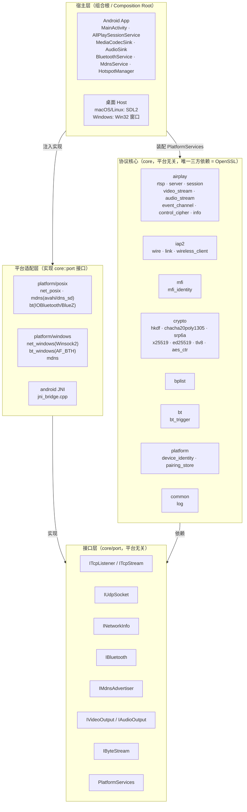
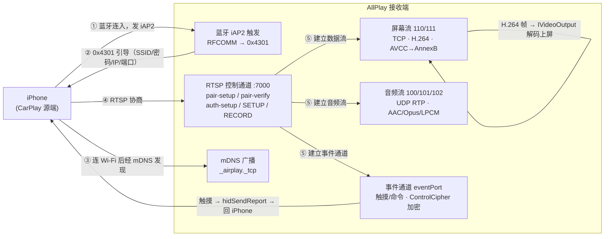

# AllPlay —— 无线 CarPlay 接收端（分层、跨平台，安卓优先）

实现一个**无线 CarPlay 接收端**：iPhone 经蓝牙触发、同一局域网投屏，本程序接收视频并显示、播放音频、回传触摸。
核心是**平台无关 C++**，安卓为产品目标（MediaCodec 解码 / AudioTrack 播放），mac/Linux 保留为
开发/自测脚手架，Windows 后续。

## 架构





> 模块职责表与平台适配矩阵见 [`docs/architecture.md`](docs/architecture.md)。

## 许可与约束

本项目为 **GPL-3.0**，是 **DiPlay / xcertplay**（均为 GPL-3.0）无线 CarPlay 接收端的 **C++ 重新实现**；
许可全文见 `LICENSE`，upstream 署名见 `THIRD_PARTY_NOTICES.md`。

- 参照 **AirPlay / iAP2 / CarPlay 协议行为**，协议事实整理在 `docs/PROTOCOL-NOTES.md`。
- `identity/` 的 MFi 身份凭证（pk8/p7b）为**单独引入的凭证文件（非代码）**，不入库、需自行准备（见 `.gitignore`）。
- 依赖只用**系统库**：核心唯一第三方 = OpenSSL；各平台用系统 API
  （Android：BluetoothSocket/NsdManager/MediaCodec/Surface；桌面：SDL2/ffmpeg/BlueZ/Avahi）。

## 分层（ports & adapters）

```
core/            平台无关协议核心（唯一三方依赖 OpenSSL；无任何平台头）
  port/          抽象接口：IByteStream / ITcpListener·ITcpStream / IBluetooth /
                 IMdnsAdvertiser / INetworkInfo / IVideoOutput + PlatformServices 组合根注入
  crypto/ bplist/ iap2/ airplay/ mfi/  协议实现
platform/posix   Linux+macOS 适配（socket / avahi·dns_sd / bluez·IOBluetooth）
android/         Android 工程（Gradle：Kotlin + NDK C++ core + JNI → 系统 API）
host/            桌面开发宿主（SDL2，仅验收用）
```

## 当前状态

| 里程碑 | 内容 | 状态 |
|---|---|---|
| M0 | 骨架：CMake + SDL 窗口/状态栏 + 脚本 | ✅ |
| M1 | core：RTSP + `/info`(bplist) + mDNS 广播 `_airplay._tcp` | ✅ |
| M2 | 蓝牙触发：iAP2 协议栈（识别/MFi/订阅/0x5703/0x4301） | ✅ 软件完成（`iap2_test` 全绿）；Linux 蓝牙传输层（BlueZ）待做 |
| M3 | 会话+视频：pair-setup/verify、auth-setup、SETUP、ControlCipher、屏幕流 | ✅ **安卓端到端跑通**（`m3_test` 全绿：SRP 对 Python 参考向量 + 假手机全流程 + mock 屏幕流；真机：MediaCodec 解码上屏 + 触摸回传 + 音频播放）；⏳ 桌面 ffmpeg 解码待接 |
| M4 | 状态栏信息 + 健壮性（重连/关键帧恢复/watchdog） | 部分（关键帧恢复已接） |
| M5 | UI 状态页/叠加（原生） | |

**自测（无硬件）**：`./build/iap2_test identity`、`./build/m3_test`（均全绿）。
**身份文件**：`identity/{identity.pk8, certificate.p7b}`（MFi 配件凭证，不入库，需自行准备）。

## 构建

```bash
# 桌面（mac/Linux）：core + posix 适配 + 自测（无需 SDL2/ffmpeg 即可编 core 与测试）
scripts/build.sh            # 产物：build/{core_selftest,iap2_test,m3_test[,allplay_host]}
./build/m3_test

# 安卓（产品）：需 Android SDK + NDK + 为 ABI 交叉编译 OpenSSL
#   cd android && ./gradlew :app:assembleDebug
#   （详见 android/app/src/main/cpp/CMakeLists.txt 顶部说明）
```

## 运行环境要求（真机）

- **Android**：8.0+（minSdk 28），蓝牙权限、同一局域网、iPhone 与本机蓝牙配对。
- **桌面（开发/验收）**：Ubuntu 20.04+ 或 macOS；蓝牙适配器；`avahi-daemon`（Linux）或系统 mDNS（macOS）。
- mDNS 广播 `_airplay._tcp`、发现 `_carplay-ctrl._tcp`。

## 排障

- **窗口起不来/字体缺失**（桌面）：`scripts/bootstrap.sh` 装 `fonts-dejavu-core`。
- **看状态栏**（桌面）：左下状态点 = 状态（灰=空闲、黄=等配对、绿=视频流、红=错误），右侧 = 分辨率/fps/帧数。
