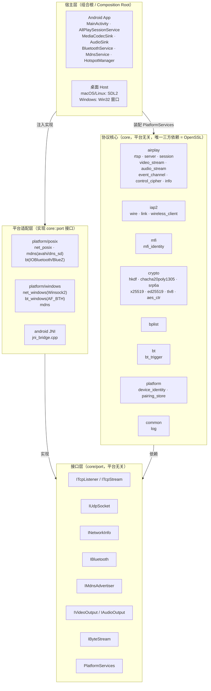
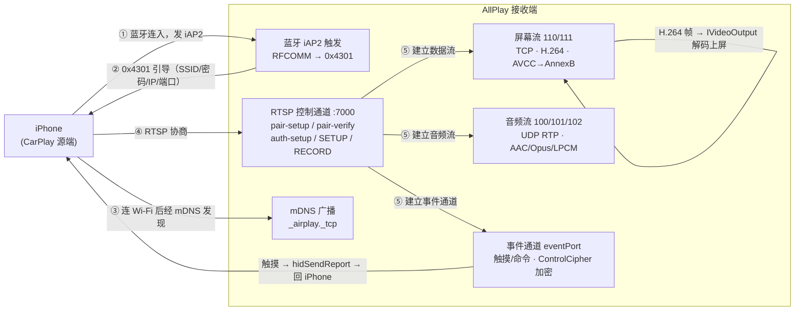

# AllPlay 架构框架图

> 图用 Mermaid 绘制，GitHub / VS Code（装 Mermaid 插件）/ Typora 都能直接渲染。

## 一、分层架构（ports & adapters）

## 二、无线 CarPlay 数据流

## 三、核心模块职责

| 模块 | 职责 |
|---|---|
| `airplay/rtsp` | 极简 RTSP 服务器（控制通道，pair-verify 后加密） |
| `airplay/session` | 会话状态机：pair-setup / pair-verify / auth-setup / SETUP |
| `airplay/video_stream` | 屏幕流：128B 头解密 → AVCC→AnnexB → 关键帧闸门 |
| `airplay/audio_stream` | 音频流：RTP over UDP 解密 + RTP 序号乱序重排 |
| `airplay/event_channel` | 事件通道：触摸 HID 回传 + forceKeyFrame 命令 |
| `iap2/wireless_client` | 蓝牙侧 iAP2 控制流程（0xAA00~0xAA05 / 0x1D00 / 0x5703 / 0x4301） |
| `mfi/mfi_identity` | MFi 配件身份（证书 + ECDSA 签名，接口可换硬件芯片） |
| `crypto/*` | 全部加密原语从零实现（不依赖第三方协议库） |
| `bt/bt_trigger` | 蓝牙触发编排（选设备 → RFCOMM → iAP2 → 0x4301） |

## 四、平台适配矩阵

| 能力 | macOS | Linux | Android | Windows |
|---|---|---|---|---|
| TCP/UDP | POSIX socket | POSIX socket | Socket | Winsock2 ✅ |
| 网卡信息 | getifaddrs | getifaddrs | NetworkInterface | GetAdaptersAddresses ✅ |
| 蓝牙 | IOBluetooth | BlueZ(待做) | BluetoothSocket | AF_BTH(待接入) |
| mDNS | dns_sd | avahi | NsdManager/JmDNS | 桩(待做) |
| 视频输出 | ffmpeg+SDL(待做) | ffmpeg+SDL(待做) | MediaCodec ✅ | ffmpeg(待做) |
