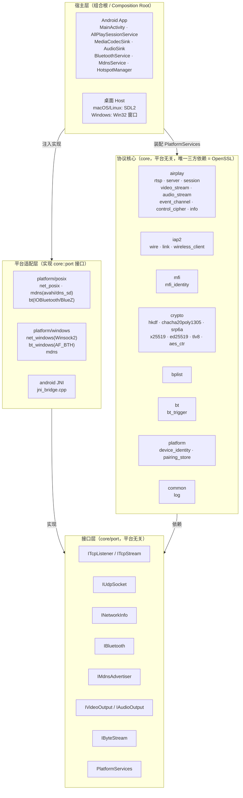
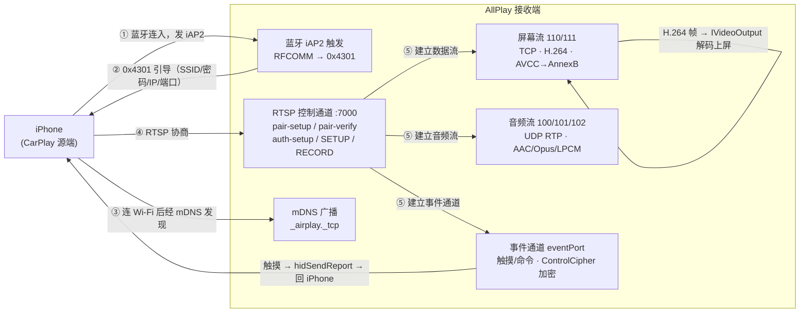

# AllPlay 架构

> 图用 Mermaid 绘制，GitHub / VS Code（装 Mermaid 插件）/ Typora 都能直接渲染。
> README 讲"这是什么、怎么跑"；这里讲**规则与契约** —— 改代码前该知道的那部分。

## 一、分层与四条规则



**四条规则**（改代码时按这个判断该放哪）：

1. **`core/` 里不许出现平台头。** 不 include `<sys/socket.h>` / `<SDL.h>` / `<jni.h>`，
   唯一的三方依赖是 OpenSSL。`core/` 要能脱离任何平台单独编译 —— `m3_test` / `iap2_test`
   就是这条规则的活证据（它们只链 `allplay_core`）。
2. **平台差异只走 `core/port/*.h`。** 需要一个新能力（比如读电池电量），
   先在 `core/port/` 定义接口，再去各平台实现，**而不是**在 core 里 `#ifdef __ANDROID__`。
3. **宿主层是唯一的组合根。** 没人比宿主更清楚"这台机器上蓝牙该用哪个实现"。
   `host/main.cpp`、`android/.../jni_bridge.cpp`、各 `tools/*.cpp` 各自装配自己的那份。
4. **依赖单向朝内。** `host → platform → port ← core`。core 不认识 platform，platform 不认识 host。

## 二、无线 CarPlay 数据流



第 ① 步是**客户端模式**：我们主动连 iPhone 的 iAP2 SPP 服务（`00000000-deca-fade-deca-deafdecacafe`），
不是等手机连我们 —— 车机端就该这么干，手机只在收到我们的连接之后才往下走。

## 三、核心模块职责

| 模块 | 职责 |
|---|---|
| `airplay/rtsp` | 极简 RTSP 服务器（控制通道，pair-verify 后整条加密） |
| `airplay/server` | `Receiver`：组合根之外的门面，起 RTSP + mDNS 广播，持有 `PlatformServices` |
| `airplay/session` | 会话状态机：pair-setup / pair-verify / auth-setup / SETUP / RECORD |
| `airplay/video_stream` | 屏幕流：128B 头解密 → AVCC→AnnexB → 关键帧闸门 |
| `airplay/audio_stream` | 音频流：RTP over UDP 解密 + 序号乱序重排 |
| `airplay/event_channel` | 事件通道：触摸 HID 回传（最多 2 触点）+ `/command` 命令 |
| `airplay/control_cipher` | 控制通道帧加密（ChaCha20-Poly1305，双向独立计数器） |
| `airplay/info` | `/info` 的 bplist 应答（设备身份、公钥、支持的流） |
| `iap2/wire` | iAP2 线格式：TLV 参数编解码、CSM 拆帧 |
| `iap2/link` | iAP2 链路层：marker→SYN→ACK→NORMAL 握手、序号与校验和 |
| `iap2/wireless_client` | 蓝牙侧控制流程（`0xAA00`~`0xAA05` / `0x1D00` / `0x5703` / `0x4301`） |
| `mfi/mfi_identity` | MFi 配件身份（证书 + ECDSA 签名）。**接口按硬件芯片的形状设计**，换芯片实现不动 core |
| `crypto/*` | 加密原语全部从零实现，不依赖第三方协议库 |
| `bplist` | Apple 二进制 plist 编解码 |
| `bt/bt_trigger` | 蓝牙触发编排：选设备 → RFCOMM → iAP2 → `0x4301` 引导 |
| `platform/device_identity` | 本机 AirPlay 身份（Ed25519 密钥对），与 MFi 身份是**两码事** |
| `platform/pairing_store` | 配对记录持久化（谁配对过、共享密钥） |

## 四、接口层契约

### `core::PlatformServices`（组合根注入的能力束）

```cpp
struct PlatformServices {
    INetworkInfo* network;      // 网卡 IP/MAC —— AirPlay 广播与 0x4301 引导要用
    IBluetooth*   bluetooth;    // 蓝牙触发；不触发可为空
    std::function<std::unique_ptr<ITcpListener>()>    makeTcpListener;      // 每用建一个
    std::function<std::unique_ptr<IMdnsAdvertiser>()> makeMdnsAdvertiser;
    std::function<std::unique_ptr<IUdpSocket>()>      makeUdpSocket;
};
```

工厂用 `std::function` 是因为监听器 / 广播器要"用几个建几个"（RTSP、数据、事件各一个端口）。

> ⚠️ **`Receiver` 会自己持有一份 `PlatformServices` 的拷贝**，不存调用方传进来的地址。
> 原因是 `Session` 到 SETUP 才第一次用 `makeTcpListener`，那时 `start()` 早已返回 ——
> 存地址就是悬垂指针，症状是 SETUP 阶段 SIGSEGV。

### `core::IVideoOutput`

| 方法 | 约定 |
|---|---|
| `configure(codec, w, h, codecData)` | `codecData` = **剥掉 fourcc 的 avcC/hvcC 记录体**（首字节 `0x01`）。`w/h` 只是协商值，真实分辨率看码流 SPS。**会被重复调用**，配置没变必须跳过重建，否则周期性黑帧 |
| `feedAnnexB(data, len)` | 喂 AnnexB 帧。**返回 `false` 代价很高** —— core 会重新放闸并立刻向手机请求关键帧。只在解码器真的不可用时才返回 false |
| `reset()` | 关键帧恢复：清解码器 + **清帧队列**（否则恢复后还在显示陈旧帧） |
| `flush()` | 新 IDR 前清参考链。core 目前不调用 |

### `core::IAudioOutput`

`configure()` 每次 SETUP 音频流重建时调用一次；`feed()` 给的是**裸帧** ——
AAC-LC 无 ADTS 头（且会把 ≤12 字节的 config 小包也喂进来，要忽略）、Opus 裸包、LPCM 裸 PCM。
`sample` 是 RTP 时间戳，供重排与时钟用。

### `core::IBluetooth`

`pairedDevices()` / `connectRFCOMM(addr, uuid, err)` / `waitForPhoneConnection()`。
**返回的流不归调用方所有**，别 delete。

## 五、线程模型（本项目最容易出错的地方）

`core` 内部起了这些线程：

| 线程 | 在哪起 | 它会调你的哪个回调 |
|---|---|---|
| RTSP accept | `rtsp.cpp:135` | 每个连接一条处理线程 |
| ScreenStream | `video_stream.cpp:30` | `IVideoOutput::configure()` + `feedAnnexB()` |
| AudioStream | `audio_stream.cpp:44` | `IAudioOutput::feed()` |
| EventChannel | `event_channel.cpp:110` | — |
| 关键帧 / NTP / keep-alive | `session.cpp:451 / 472 / 504` | — |

**关键的不对称**（踩过一次，见 CHANGELOG v0.2 的修复）：

| 回调 | 来自哪个线程 |
|---|---|
| `IVideoOutput::configure()` / `feedAnnexB()` | **ScreenStream 线程** |
| `IVideoOutput::reset()` | **RTSP 线程**（`/command forceKeyFrame` 或丢关键帧后触发） |
| `IAudioOutput::configure()` | **RTSP 线程**（SETUP 里） |
| `IAudioOutput::feed()` | **AudioStream 线程** |

也就是说 **`reset()` 与 `feedAnnexB()` 是两个线程**在碰同一份解码器状态 ——
平台实现**必须自己加锁**，core 不管。

另外一条既有约定：**SDL 只在主线程调用**。所以音频设备的 open/close 不能直接在
`configure()`（RTSP 线程）里做，只能写一个原子 pending 标志，由主循环发现后处理。
宿主侧的实际做法见 `host/media/sdl_audio_sink.cpp` 的注释。

## 六、平台适配矩阵

| 能力 | Linux | macOS | Android | Windows |
|---|---|---|---|---|
| TCP / UDP | POSIX socket ✅ | POSIX socket ✅ | Socket ✅ | Winsock2 ✅ |
| 网卡信息 | `getifaddrs` ✅ | `getifaddrs` ✅ | `NetworkInterface` ✅ | `GetAdaptersAddresses` ✅ |
| 蓝牙 | **BlueZ**（SDP + 裸 RFCOMM，客户端模式）✅ 真机验到 `0xAA00` | IOBluetooth ⏳ 未真机验收 | `BluetoothSocket` ✅ | `AF_BTH` ⏳ 骨架 |
| mDNS | avahi ✅ | dns_sd ✅ | `NsdManager` ✅ | ⏳ 待做 |
| 视频输出 | ffmpeg 软解 + SDL2 ✅ | ffmpeg 软解 + SDL2 ✅ | MediaCodec 硬解 ✅ | ffmpeg ⏳ 待接 |
| 音频输出 | SDL2（AAC-LC / Opus / LPCM）✅ | SDL2 ✅ | AudioTrack ✅ | ⏳ 待接 |
| 桌面宿主 | ✅ 端到端跑通 | ✅ 端到端跑通 | —（用原生 App） | ⏳ 仅有窗口 |

对应实现文件：

```
platform/posix/  net_posix.cpp      mdns_avahi.cpp | mdns_dns_sd.cpp
                 bt_bluez.cpp      | bt_iobluetooth.mm
platform/windows/ net_windows.cpp   bt_windows.cpp
android/.../cpp/  jni_bridge.cpp
```

## 七、接一个新平台要做什么

按依赖顺序，每一步都能单独验证：

1. **`net`**：实现 `INetworkInfo` + `ITcpListener`/`ITcpStream` + `IUdpSocket`。
   验证：`core_selftest` 能起来、`/info` 能应答。
2. **`mdns`**：实现 `IMdnsAdvertiser`（广播 `_airplay._tcp`）。
   验证：`avahi-browse -t _airplay._tcp`（或对应平台的工具）能看到。
3. **`video`**：实现 `IVideoOutput`。**先别碰协议** —— 用 `tools/video_probe` 的思路
   本地喂一段 H.264，把"解码 + 上屏"跑通再往下走。
4. **`audio`**：实现 `IAudioOutput`（三个格式，至少要能忽略 AAC 的 config 小包）。
5. **`bluetooth`**：实现 `IBluetooth`。Linux 上是**客户端模式**（我们连手机），
   别照着"服务端等手机连"的思路写。
6. **宿主**：把上面几件装配成 `PlatformServices` + `ReceiverConfig`，起主循环。
7. **验收**：`tools/fake_phone` 跑端到端（不需要 iPhone），再拿真机验蓝牙那一段。
